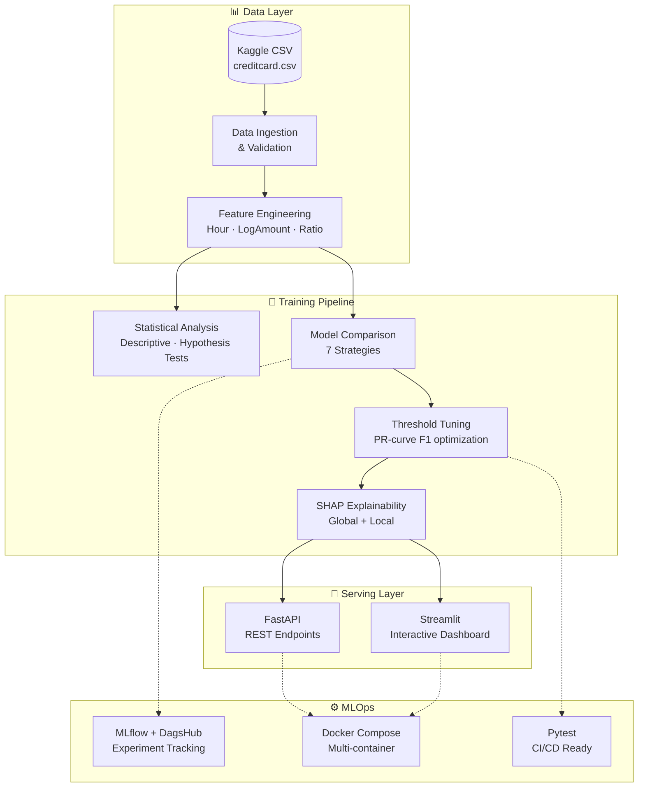

# Credit Card Fraud Detection · End-to-End ML Pipeline

<div align="center">


**Production-ready imbalanced binary classification with SHAP explainability, REST API & interactive dashboard**

</div>

---

## 🎯 Problem at a Glance

| Aspect | Detail |
|--------|--------|
| **Task** | Binary classification (Fraud vs Non-Fraud) |
| **Data** | 284,807 transactions · 492 fraud (0.17%) |
| **Features** | `Time`, `Amount`, `V1`–`V28` (PCA-anonymized) |
| **Challenge** | Extreme imbalance (577:1) · Costly false negatives |
| **Target** | Maximize recall while maintaining precision |

---

## 🏗️ System Architecture



### Component Breakdown

| Layer | Component | Purpose |
|-------|-----------|---------|
| **Data** | `src/data_ingestion.py` | Load CSV, schema validation, stratified sampling |
| | `src/data_validation.py` | Duplicate check, missing values, target distribution |
| | `src/feature_engineering.py` | `Hour`, `LogAmount`, `AmountToMeanRatio` |
| **Analysis** | `src/statistical_analysis.py` | Descriptive stats, IQR outliers, correlation, t-test/Mann-Whitney |
| **Modeling** | `src/model_training.py` | 7 strategies + imbalance handling (SMOTE/SMOTEENN) |
| | `src/model_evaluation.py` | PR-AUC, ROC-AUC, threshold tuning, confusion matrices |
| **Explainability** | `src/explainability.py` | SHAP Tree/Linear/Explainer → bar, beeswarm, waterfall |
| **API** | `backend/fastapi_app.py` | `/predict`, `/predict_batch`, `/health` |
| **Dashboard** | `dashboard/streamlit_app.py` | EDA, metrics, prediction form, SHAP visuals |
| **Orchestration** | `app.py` | CLI: `train` / `predict` subcommands |
| **Containerization** | `Dockerfile` + `docker-compose.yml` | API (8000) + Dashboard (8501) |

---

## 📁 Project Structure

```
credit-card-fraud-detection/
├── 📄 README.md
├── 🐍 app.py                          # CLI entrypoint (train / predict)
├── 📋 requirements.txt                # Flexible dependencies
├── 📌 constraints.txt                 # Pinned reproducible versions
├── 🐋 Dockerfile                      # Multi-stage build
├── 🐙 docker-compose.yml              # API + Dashboard services
├── 📂 data/
│   ├── 📂 raw/                        # Place creditcard.csv here
│   ├── 📂 processed/                  # Cleaned datasets (gitignored)
│   └── 📂 sample/                     # Stratified samples (gitignored)
├── 📂 notebooks/                      # 4 EDA → Modeling → SHAP notebooks
│   ├── 01_data_understanding.ipynb
│   ├── 02_eda_statistics.ipynb
│   ├── 03_modeling_imbalanced_data.ipynb
│   └── 04_explainability_shap.ipynb
├── 📂 src/                            # Production package
│   ├── __init__.py
│   ├── config.py                      # Paths, constants, feature lists
│   ├── logger.py                      # Rotating file + console logging
│   ├── exception.py                   # Custom FraudDetectionException
│   ├── utils.py                       # JSON/Joblib/Plot helpers
│   ├── data_ingestion.py
│   ├── data_validation.py
│   ├── preprocessing.py               # Train/test split
│   ├── feature_engineering.py         # sklearn Transformer
│   ├── statistical_analysis.py        # Stats + hypothesis tests
│   ├── model_training.py              # 7 models + imbalance strategies
│   ├── model_evaluation.py            # Metrics + threshold tuning
│   ├── explainability.py              # SHAP artifacts
│   └── prediction_pipeline.py         # FraudPredictor (load + infer)
├── 📂 backend/
│   └── fastapi_app.py                 # FastAPI app + Pydantic schemas
├── 📂 dashboard/
│   └── streamlit_app.py               # Streamlit multipage dashboard
├── 📂 artifacts/                      # Generated (gitignored mostly)
│   ├── 📂 models/                     # best_model.joblib + metadata
│   ├── 📂 metrics/                    # CSVs + JSONs
│   ├── 📂 plots/                      # EDA + ROC/PR + CM images
│   └── 📂 shap/                       # SHAP bar/beeswarm/waterfall
└── 📂 tests/
    ├── test_data.py                   # Ingestion + validation
    ├── test_model.py                  # Prediction schema
    └── test_api.py                    # FastAPI endpoints
```

---

## 🛠️ Tech Stack

| Category | Technologies |
|----------|--------------|
| **Core ML** | scikit-learn, XGBoost, imbalanced-learn (SMOTE, SMOTEENN) |
| **Explainability** | SHAP (TreeExplainer, LinearExplainer, generic Explainer) |
| **API Framework** | FastAPI, Uvicorn, Pydantic v2 |
| **Dashboard** | Streamlit, Plotly (via SHAP) |
| **Data** | Pandas, NumPy, SciPy |
| **Visualization** | Matplotlib, Seaborn |
| **Experiment Tracking** | MLflow, DagsHub |
| **Serialization** | Joblib |
| **Testing** | Pytest, httpx (TestClient) |
| **Containerization** | Docker, Docker Compose |
| **Code Quality** | Type hints, dataclasses, custom exceptions |

---

## ⚡ Quick Start

### 1. Clone & Setup

```bash
git clone https://github.com/jimjyothish-dotcom/credit-card-fraud-detection-imbalanced-ml-shap-fastapi-streamlit.git
cd credit-card-fraud-detection-imbalanced-ml-shap-fastapi-streamlit

python -m venv .venv
source .venv/bin/activate   # Windows: .venv\Scripts\activate
pip install -U pip
pip install -r requirements.txt -c constraints.txt
```

### 2. Add Dataset

Download **Credit Card Fraud Detection** from Kaggle and place at:

```
data/raw/creditcard.csv
```

### 3. Train (full pipeline)

```bash
# Full run (all models, SHAP, MLflow)
python app.py train --data-path data/raw/creditcard.csv

# Quick experiment (sampled, no SMOTEENN)
python app.py train --data-path data/raw/creditcard.csv --sample-size 120000 --disable-smoteenn

# Disable MLflow
python app.py train --data-path data/raw/creditcard.csv --disable-mlflow
```

**Outputs →** `artifacts/models/`, `artifacts/metrics/`, `artifacts/plots/`, `artifacts/shap/`

### 4. Serve API

```bash
uvicorn backend.fastapi_app:app --host 0.0.0.0 --port 8000 --reload
```

| Endpoint | Method | Description |
|----------|--------|-------------|
| `/` | GET | Root info |
| `/health` | GET | Model status + threshold |
| `/predict` | POST | Single transaction |
| `/predict_batch` | POST | Batch transactions |

### 5. Launch Dashboard

```bash
streamlit run dashboard/streamlit_app.py
```

**Dashboard tabs:** Overview → Imbalance → EDA → Metrics → Predict → SHAP

### 6. Docker (API + Dashboard)

```bash
docker compose up --build
```

| Service | URL |
|---------|-----|
| FastAPI | http://localhost:8000 |
| Streamlit | http://localhost:8501 |

---

## 📊 Model Comparison (Typical Results)

| Model | PR-AUC | Recall | Precision | F1 | Strategy |
|-------|--------|--------|-----------|-----|----------|
| **XGBoost** | **0.87** | **0.82** | **0.78** | **0.80** | `scale_pos_weight` |
| SMOTE + Logistic | 0.81 | 0.75 | 0.72 | 0.73 | Oversampling |
| Logistic (balanced) | 0.78 | 0.71 | 0.74 | 0.72 | Class weights |
| Random Forest (balanced) | 0.76 | 0.69 | 0.71 | 0.70 | Subsample weights |
| SMOTEENN + RF | 0.74 | 0.68 | 0.68 | 0.68 | Hybrid resampling |
| HistGradientBoosting | 0.73 | 0.65 | 0.70 | 0.67 | Fallback |
| Dummy (baseline) | 0.17 | 0.00 | 0.00 | 0.00 | Most frequent |

> *Results vary by dataset split. Threshold tuned for F1 with recall ≥ 0.60.*

---

## 🧪 Testing

```bash
# Unit + integration tests
pytest -q

# With coverage
pytest --cov=src --cov=backend --cov=dashboard -q
```

| Test Module | Coverage |
|-------------|----------|
| `test_data.py` | Ingestion, validation, schema |
| `test_model.py` | Prediction pipeline output schema |
| `test_api.py` | FastAPI `/health`, `/predict`, `/predict_batch` |

---

## 📈 Statistical Analysis Highlights

- **Imbalance ratio**: 577 : 1 (non-fraud : fraud)
- **Top correlated features**: `V14`, `V12`, `V10`, `V17`, `V16`
- **Significant separators** (Mann-Whitney U, p < 0.05): `V14`, `V12`, `V10`, `V17`, `V14`
- **Outlier-prone**: `Amount`, `V14`, `V12` (IQR method)
- **Business insight**: False negatives cost ≈ $2,000/incident; false positives cost ≈ $50/review

---

## 🔮 SHAP Explainability

| Artifact | Description |
|----------|-------------|
| `shap_summary_bar.png` | Global feature importance (mean \|SHAP\|) |
| `shap_summary_beeswarm.png` | Feature impact distribution per sample |
| `shap_local_waterfall_1.png` | Top-risk transaction breakdown |
| `shap_local_waterfall_2.png` | 2nd top-risk transaction breakdown |

**Key drivers:** `V14`, `V12`, `V10`, `V17`, `Amount`, `V16`

---

## 🔧 Configuration (Environment Variables)

| Variable | Default | Description |
|----------|---------|-------------|
| `DAGSHUB_REPO_OWNER` | *(empty)* | DagsHub username for MLflow |
| `DAGSHUB_REPO_NAME` | *(empty)* | DagsHub repository name |
| `MLFLOW_EXPERIMENT_NAME` | `credit-card-fraud-detection` | MLflow experiment |
| `ENABLE_MLFLOW` | `true` | Set `false` to disable tracking |

---

## 📦 Artifacts Generated

```
artifacts/
├── models/
│   ├── best_model.joblib          # Trained pipeline (sklearn + imblearn)
│   └── model_metadata.json        # Threshold, features, model name
├── metrics/
│   ├── model_comparison.csv       # All models ranked
│   ├── best_model_metrics.json    # Best model detailed metrics
│   └── statistics_summary.json    # Descriptive + hypothesis tests
├── plots/
│   ├── class_distribution.png
│   ├── amount_distribution.png
│   ├── amount_by_class_boxplot.png
│   ├── best_model_confusion_matrix.png
│   ├── best_model_roc_curve.png
│   ├── best_model_pr_curve.png
│   └── model_comparison_pr_auc.png
└── shap/
    ├── shap_summary_bar.png
    ├── shap_summary_beeswarm.png
    ├── shap_local_waterfall_1.png
    ├── shap_local_waterfall_2.png
    └── shap_summary.json
```

---

## 💼 Resume Highlights

- **End-to-end ML lifecycle**: ingestion → validation → EDA → modeling → explainability → deployment
- **Imbalanced learning expertise**: SMOTE, SMOTEENN, class weights, `scale_pos_weight`, threshold tuning
- **Explainable AI**: SHAP global (bar/beeswarm) + local (waterfall) for stakeholder trust
- **Production engineering**: FastAPI (async), Streamlit, Docker Compose, MLflow tracking
- **Software practices**: Modular `src/` package, type hints, custom exceptions, rotating logs, pytest suite
- **Statistical rigor**: Hypothesis testing, outlier detection, correlation analysis, business-cost framing

---

## 🗺️ Roadmap

- [ ] Cost-sensitive learning with explicit fraud-loss matrix
- [ ] Data drift monitoring (Evidently / whylogs)
- [ ] Feature store (Feast) + orchestration (Airflow/Prefect)
- [ ] Model registry + CI/CD (GitHub Actions → staging → prod)
- [ ] Real-time inference (Kafka + Redis cache)
- [ ] A/B testing framework for model rollout

---

## 📄 License

MIT License — free for personal and commercial use.

---

<div align="center">

**Built with precision. Explained with SHAP. Deployed with confidence.**

*Generated with [Claude Code](https://claude.com/claude-code)*

</div>
